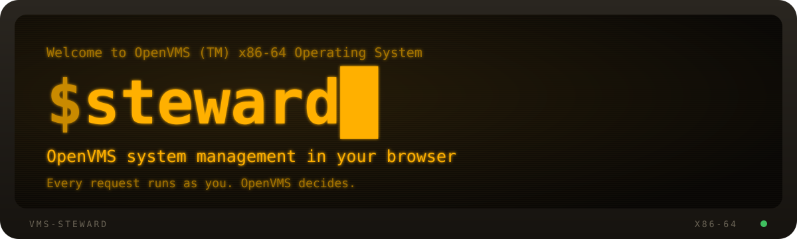
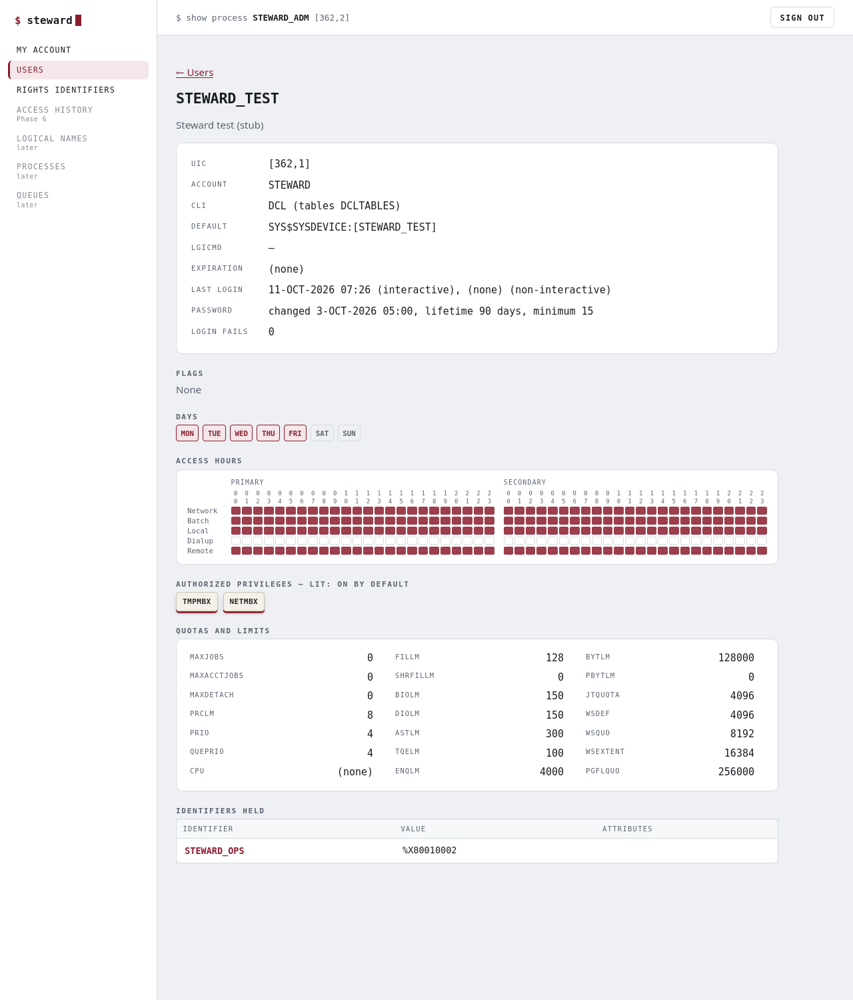

# vms-steward



**[steward.issinoho.com](https://steward.issinoho.com)** · [Download](https://github.com/issinoho/vms-steward/releases/latest)

Browser-based system management for OpenVMS, served over HTTPS by
[vms-lighttpd](https://github.com/issinoho/vms-lighttpd) as a FastCGI service with a
REST API and a static web front end.

Users sign in with their own OpenVMS username and password, checked by `SYS$ACM`. Every
request then runs under that user's persona, so OpenVMS itself decides what they may
see and change.



## Status

**0.9.0, an early test release** for OpenVMS x86-64: a PCSI kit is on the
[releases page](https://github.com/issinoho/vms-steward/releases). It opens on a dashboard
of the system, covers users and rights identifiers (what AUTHORIZE does, from
creating and copying accounts to deleting them), shows the system's access
history (who signed in, when, from where and by which route), and lets you browse
logical names as `SHOW LOGICAL` shows them to you, and define and deassign them as
DEFINE and DEASSIGN do. Please try it on a test system first and report what you find.

Phases 1 to 10 are closed: sign-in, the read-only views, changes, creating and
deleting users, hardening (a load run and soak, [`docs/PHASE5.md`](docs/PHASE5.md)),
access history, logical names, processes, queues and system parameters. Their exit checks passed on the x86 test system and in a browser
through nginx proxy manager. An independent code review and an external review and
penetration test are still to come ([`docs/REVIEW-BRIEF.md`](docs/REVIEW-BRIEF.md)). See [`docs/PLAN.md`](docs/PLAN.md),
[`docs/api.md`](docs/api.md) and [`docs/security.md`](docs/security.md).

| Area | Status |
| --- | --- |
| Dashboard: the system at a glance (vms-fastfetch's figures) | done (0.2.0) |
| Scaffolding, sign-in, sessions | done (Phase 1, closed 2026-10-10) |
| Users and rights identifiers: read-only views | done (Phase 2, closed 2026-10-10) |
| Users and rights identifiers: changes, passwords, grants | done (Phase 3, closed 2026-10-11) |
| Users: create, copy, delete | done (Phase 4, closed 2026-10-11) |
| Hardening: load run, soak, review of the new code | done (Phase 5, closed 2026-10-11; external review open) |
| Access history: who connected, when, how (SSH, TELNET, DECnet, LAT, batch, Steward) in one view | done (Phase 6, closed 2026-10-11) |
| Logical names: tables, names and translations, read-only | done (Phase 7a, closed 2026-10-13, 0.5.1) |
| Logical names: define, change and deassign | done (Phase 7b, closed 2026-10-15, 0.6.2) |
| Processes: the list and one process, read-only | done (Phase 8a, closed 2026-10-15, 0.7.0 test kit) |
| Processes: stop a process (never Steward's own or a system process) | done (Phase 8b, closed 2026-10-15, 0.7.2) |
| Queues: the queues, their jobs, one job, read-only | done (Phase 9a, closed 2026-10-15, 0.8.0 test kit) |
| Queues: hold, release, delete a job; stop and start a queue (never Steward's start-up queues) | done (Phase 9b, closed 2026-10-15, 0.8.1) |
| System parameters, read-only (as SYSGEN SHOW/ALL) | done (Phase 10, closed 2026-10-16, 0.9.0) |
| Licences: loaded, the charge, and the database where OpenVMS lets you read it (read-only) | done (Phase 11, closed 2026-10-16, 0.10.1) |
| Installed products: PCSI's list and history, VMSINSTAL's history (read-only) | done (Phase 12a, closed 2026-10-17, 0.11.0) |
| Monitoring: CPU by mode, process states, memory, paging, I/O and disks over time, and the busiest processes (read-only) | done (Phase 13a, closed 2026-10-17, 0.12.0); history recorded on the node (Phase 13b, closed 2026-10-17, 0.13.0) |
| Error log: device error counts, the events in ERRLOG.SYS (translated by ELV), CLUE's crash summaries and OPCOM's log (read-only) | done (Phase 14a, closed 2026-10-17, 0.14.0) |
| Terminal | later |

## Installing

Needs OpenVMS x86-64, VSI TCP/IP Services, VSI SSL3, and
[vms-lighttpd](https://github.com/issinoho/vms-lighttpd) installed and set up. Browsers
must reach Steward over HTTPS, through a proxy that ends TLS or with TLS in lighttpd.

```
$ PRODUCT INSTALL STEWARD /SOURCE=dev:[dir]
$ @STEWARD$ROOT:[COM]STEWARD$CONFIGURE         ! once, as SYSTEM
$ ! add the include line it prints to lighttpd's LIGHTTPD.CONF, then:
$ @STEWARD$ROOT:[COM]STEWARD$CONTROL START
$ @VMSLIGHTTPD$ROOT:[COM]VMSLIGHTTPD$CONTROL RESTART
```

To start at boot, answer YES to STEWARD$CONFIGURE's autostart question (or set
`steward_autostart` to `"YES"` in `SYS$MANAGER:STEWARD$CONFIG.COM`). Then add
`@SYS$STARTUP:STEWARD$STARTUP` to `SYSTARTUP_VMS.COM`, after TCP/IP, SSL3 and the queues:
it starts the pool by submitting a job to `SYS$BATCH` as the service account. Add
`@SYS$STARTUP:STEWARD$SHUTDOWN` to `SYSHUTDWN.COM`. vms-lighttpd needs its own autostart too.

Two account points:
- **lighttpd's account.** Give STEWARD$CONFIGURE the account vms-lighttpd really runs as
  (normally `LIGHTTPD`). It becomes the only reader of the gateway secret. If lighttpd
  cannot read that file, it refuses its whole configuration and serves no site at all.
- **The service account** must keep batch access and must not be disabled.

`[STEWARD.DOC]README.VMS` in the kit has the details:
- the service account and why it holds what it holds;
- the gateway secret;
- starting at boot;
- running STEWARD$CONFIGURE again: it offers your earlier answers, except lighttpd's
  account, which is always vms-lighttpd's;
- running behind a reverse proxy;
- the audit log.

`tools/kit.sh <node>` builds the kit (`kit/`).

## Building

```sh
make test            # core unit tests (Linux, stub platform)
make api-test        # the real server over FastCGI
make audit           # analyzers, sanitizers, fuzzing, project rules (D8)
make ui-test         # the front end in node + jsdom against the stub (needs jsdom in tests/ui)
make dev             # the front end at http://127.0.0.1:8080/ on the stub platform
```

On OpenVMS: `@BUILD_VMS TEST` (VSI C, OpenSSL 3). The pool is run by
`vms/steward_pool.com` behind lighttpd (`vms/steward.conf`).

## Platform

OpenVMS x86-64 first (VSI C, VSI TCP/IP Services, VSI OpenSSL 3). The code is portable
C99, and the service also builds and runs on Linux against an in-memory stub platform
for development and tests. An IA64 kit builds and passes the live tests, but is not yet
usable in a browser: that port is on hold (docs/IA64.md).

vms-steward is an independent project. It is not affiliated with VMS Software Inc. and is
not derived from any VSI product.

## Licence

MIT. See `LICENSE`.
